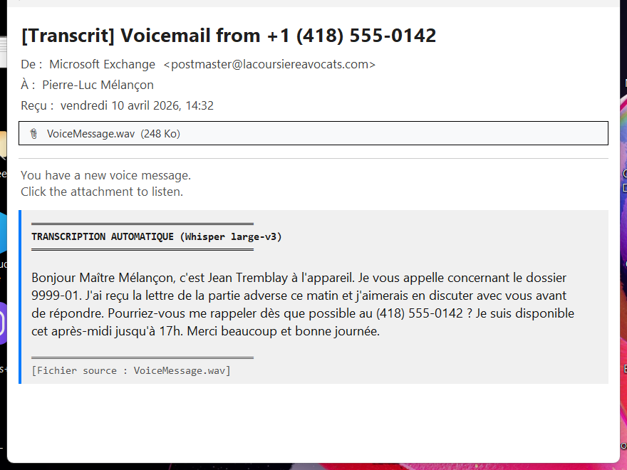
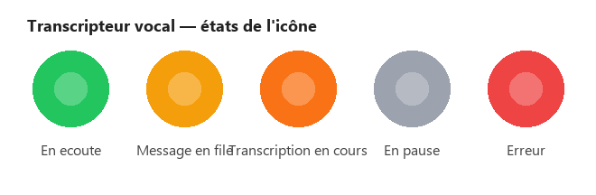
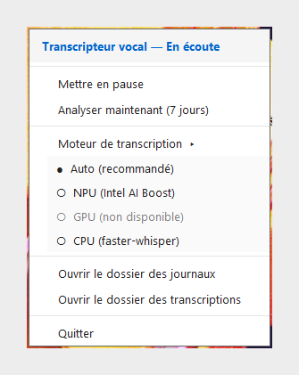

# Voicemail Transcriber

**Service de surveillance Outlook qui transcrit automatiquement les messages vocaux** en utilisant OpenAI Whisper. Tourne en arrière-plan comme icône dans la barre des tâches, sans interface principale — la transcription est ajoutée directement au corps du courriel original.


---

## Aperçu

Lorsqu'un message vocal arrive par courriel (de Teams, d'un PBX, d'un opérateur téléphonique…), le service détecte la pièce jointe audio, la transcrit avec Whisper, et ajoute le texte directement dans le corps du courriel — sans créer de nouveau message, sans envoyer les données à l'extérieur.

Tous les traitements se font **localement** sur le poste (CPU, GPU NVIDIA, ou NPU Intel AI Boost).

---

## Fonctionnalités

### Transcription locale multi-backend

Le service choisit automatiquement le meilleur moteur disponible sur le poste :

| Backend | Moteur | Quand ? |
|---------|--------|---------|
| **NPU** | OpenVINO GenAI sur Intel AI Boost | Laptops Intel Core Ultra — très rapide, zéro impact CPU |
| **GPU** | faster-whisper sur CUDA | Stations avec GPU NVIDIA — le plus rapide |
| **CPU** | faster-whisper (int8) | Tout poste Windows — fonctionne partout |

L'utilisateur peut forcer un backend spécifique via le menu de la barre des tâches.

### Détection intelligente

Le monitor surveille Outlook en continu et reconnaît les messages vocaux par :
- Mots-clés dans le sujet (`voicemail`, `messagerie vocale`, `message vocal`, `vm:`, `missed call`…)
- Pièces jointes audio (`.wav`, `.mp3`, `.m4a`, `.ogg`, `.wma`)

### Transcription ajoutée dans le courriel original

La transcription s'insère sous forme de **bloc HTML stylisé** (bordure bleue, fond gris) directement dans le corps du message. Aucun nouveau courriel créé — le message original est simplement enrichi, et son sujet est préfixé de `[TRANSCRIT]` pour éviter les retraitements.

<p align="center">
  
</p>

### Icône de statut en temps réel

L'icône dans la barre des tâches change de couleur selon l'état du service :

<p align="center">
  
</p>

| Couleur | État | Signification |
|---------|------|---------------|
| 🟢 Vert | En écoute | Le service attend de nouveaux messages |
| 🟡 Orange clair | Message en file | Un message détecté, en attente de traitement |
| 🟠 Orange | Transcription en cours | Whisper est en train de transcrire |
| ⚪ Gris | En pause | L'utilisateur a mis le service en pause |
| 🔴 Rouge | Erreur | Problème (Outlook déconnecté, modèle invalide…) |

### Menu contextuel complet

Clic droit sur l'icône donne accès à toutes les commandes :

<p align="center">
  
</p>

- **Mettre en pause / Reprendre** — interrompt temporairement la surveillance
- **Analyser maintenant (7 jours)** — force un balayage manuel des 7 derniers jours
- **Moteur de transcription** — bascule entre Auto / NPU / GPU / CPU
- **Ouvrir le dossier des journaux** — accès direct aux logs pour dépannage
- **Ouvrir le dossier des transcriptions** — historique des fichiers audio traités
- **Quitter** — arrêt propre du service

### Notifications Windows

Lorsqu'une transcription est terminée (ou qu'une erreur survient), une notification toast Windows apparaît brièvement pour informer l'utilisateur.

---

## Architecture

```
voicemail_transcriber.py    Point d'entrée legacy (openai-whisper)
voicemail_service.py        Service principal (faster-whisper + backend manager)
outlook_monitor.py          Boucle de surveillance Outlook via COM
resource_manager.py         Detection et gestion des backends (CPU/GPU/NPU)
tray_app.py                 Icône de la barre des tâches (pystray)
```

### Backends de transcription

- **`WhisperModelManager`** — faster-whisper sur CPU (par défaut, int8 pour vitesse)
- **`GpuWhisperManager`** — faster-whisper sur CUDA (auto-détecté si présent)
- **`NpuWhisperManager`** — OpenVINO GenAI sur NPU Intel (auto-détecté si présent)

Chaque backend implémente la même interface `transcribe(audio_path) → str`. Le changement de moteur via le menu décharge l'ancien modèle et charge le nouveau.

---

## Installation

### Prérequis

- Windows 10/11
- Microsoft Outlook 2016/2019/365 (version desktop)
- Python 3.11+ (seulement pour le mode développement)

### Installer le service

1. Télécharger la dernière version depuis [Releases](https://github.com/plmelancon/Voicemail-Transcriber/releases/latest)
2. Exécuter l'installateur `VoicemailTranscriber_Setup_X.X.X.exe`
3. Le service se lance automatiquement et s'enregistre au démarrage de Windows

### Depuis le code source (développement)

```bash
git clone https://github.com/plmelancon/Voicemail-Transcriber.git
cd Voicemail-Transcriber
pip install faster-whisper pywin32 pystray pillow openvino openvino-genai
python voicemail_service.py
```

---

## Configuration

Les paramètres principaux sont dans `voicemail_transcriber.py` (section `CONFIG`) :

| Clé | Défaut | Description |
|-----|--------|-------------|
| `whisper_model` | `turbo` | Taille du modèle Whisper (`tiny`/`base`/`small`/`medium`/`large`/`turbo`) |
| `language` | `fr` | Langue à transcrire (`None` = détection auto) |
| `voicemail_keywords` | *(liste)* | Mots-clés qui identifient les messages vocaux |
| `audio_extensions` | `.wav .mp3 .m4a .ogg .wma` | Extensions acceptées |
| `days_to_search` | `7` | Profondeur du balayage manuel |
| `processed_marker` | `[TRANSCRIT]` | Préfixe ajouté au sujet après traitement |

Le choix du backend (auto/NPU/GPU/CPU) se règle via le menu de la barre des tâches et se persiste entre les sessions.

---

## Emplacements

| Fichier | Emplacement |
|---------|-------------|
| Journaux | `%LOCALAPPDATA%\VoicemailTranscriber\logs\` |
| Modèles Whisper | `%LOCALAPPDATA%\VoicemailTranscriber\models\` (téléchargés au premier usage) |
| Paramètres | `%LOCALAPPDATA%\VoicemailTranscriber\settings.json` |

---

## Licence

Usage interne — Lacoursière Avocats.
